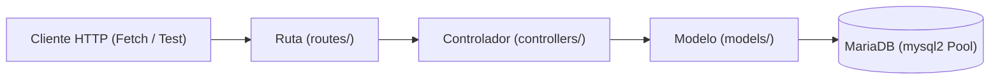

# Skill: rest-endpoint-generator

Esta Skill establece el estándar de desarrollo de la **API REST** para la aplicación **ClassManager**. Debe ser consultada y aplicada de forma obligatoria por el asistente de IA (Antigravity) cada vez que deba diseñar, implementar, revisar o refactorizar un endpoint del backend.

---

## 1. Principio Fundamental: Separación de Responsabilidades

Todo recurso de la API (Alumnos, Cursos, Matrículas) debe organizarse respetando estrictamente el patrón modular de 3 capas:



1. **Capa de Rutas (`src/routes/<recurso>Routes.js`):**
   - Su única función es asociar el verbo HTTP y la URL correspondiente con la función del controlador.
   - No contiene lógica de negocio ni manipulación de base de datos.
2. **Capa de Controladores (`src/controllers/<recurso>Controller.js`):**
   - Recibe la petición (`req`) y prepara la respuesta (`res`).
   - Extrae los parámetros (`req.params`, `req.query`, `req.body`).
   - **Valida los datos de entrada:** Si faltan datos o son inválidos, responde inmediatamente con código `400 Bad Request` sin molestar a la base de datos.
   - Invoca las funciones del modelo mediante `await`.
   - Aplica las reglas de negocio (ej. verificar si ya existe matrícula activa o si quedan plazas).
   - Envía la respuesta HTTP con el código de estado adecuado y el formato JSON uniforme.
   - Captura excepciones mediante `try/catch` y delega en el gestor de errores.
3. **Capa de Modelos (`src/models/<recurso>Model.js`):**
   - Contiene exclusivamente las consultas SQL contra MariaDB a través del pool de `mysql2/promise`.
   - Utiliza siempre **consultas parametrizadas con placeholders `?`** para evitar inyecciones SQL.
   - Retorna datos limpios (arrays u objetos de filas) o el resultado de operaciones (`insertId`, `affectedRows`).
   - No tiene acceso al objeto `req` ni `res`.

---

## 2. Formato Homogéneo de Respuestas JSON

Todas las respuestas emitidas por la API deben cumplir una de las dos estructuras estandarizadas siguientes:

### 2.1. Respuesta Satisfactoria (`success: true`)
```json
{
  "success": true,
  "data": { ... },
  "message": "Mensaje descriptivo opcional de la operación"
}
```
*Nota: Para listados, `data` será un array `[]`. Para consultas por ID o creaciones, será un objeto `{}`.*

### 2.2. Respuesta de Error (`success: false`)
```json
{
  "success": false,
  "error": "Mensaje claro y descriptivo del motivo del error"
}
```

---

## 3. Matriz de Códigos de Estado HTTP

Antigravity debe asignar el código HTTP exacto en función de la situación:

| Código HTTP | Nombre | Cuándo Utilizarlo | Ejemplo en ClassManager |
| :--- | :--- | :--- | :--- |
| **`200 OK`** | Éxito genérico | Consultas `GET` exitosas, modificaciones `PUT` exitosas o eliminaciones `DELETE` confirmadas. | `GET /api/alumnos` con array de alumnos; `PUT /api/cursos/1` actualizado. |
| **`201 Created`** | Recurso creado | Inserciones `POST` exitosas que dan de alta un nuevo registro. | `POST /api/alumnos` tras insertar el alumno; `POST /api/matriculas`. |
| **`400 Bad Request`** | Petición inválida | Datos de entrada obligatorios ausentes, formatos incorrectos o reglas de validación insatisfechas. | Campo `nombre` vacío; DNI sin formato válido; horas o plazas $\le 0$; curso sin plazas disponibles. |
| **`404 Not Found`** | No encontrado | El recurso solicitado por su identificador (`:id`) no existe en la base de datos. | `GET /api/alumnos/999` cuando el ID 999 no existe. |
| **`409 Conflict`** | Conflicto de estado | Violación de restricciones de unicidad o de integridad referencial en MariaDB. | DNI o email repetido; código de curso ya existente; alumno ya con matrícula activa en el curso; borrado bloqueado por `ON DELETE RESTRICT`. |
| **`500 Internal Server Error`** | Error del servidor | Excepciones imprevistas, fallos de red o caídas de MariaDB. | Fallo de conexión con la base de datos no controlado. |

---

## 4. Patrón Canónico de Implementación

Al generar código para un recurso, Antigravity debe seguir esta plantilla de referencia:

### 4.1. Estructura de Rutas (`src/routes/<recurso>Routes.js`)
```javascript
const express = require('express');
const router = express.Router();
const controller = require('../controllers/ejemploController');

router.get('/', controller.getAll);
router.get('/:id', controller.getById);
router.post('/', controller.create);
router.put('/:id', controller.update);
router.delete('/:id', controller.remove);

module.exports = router;
```

### 4.2. Estructura de Controlador (`src/controllers/<recurso>Controller.js`)
```javascript
const EjemploModel = require('../models/ejemploModel');

const getAll = async (req, res, next) => {
  try {
    const items = await EjemploModel.findAll();
    return res.status(200).json({
      success: true,
      data: items
    });
  } catch (error) {
    next(error);
  }
};

const getById = async (req, res, next) => {
  try {
    const { id } = req.params;
    const item = await EjemploModel.findById(id);
    
    if (!item) {
      return res.status(404).json({
        success: false,
        error: `Recurso con id ${id} no encontrado`
      });
    }

    return res.status(200).json({
      success: true,
      data: item
    });
  } catch (error) {
    next(error);
  }
};

const create = async (req, res, next) => {
  try {
    const { campo1, campo2 } = req.body;

    // 1. Validación de campos obligatorios
    if (!campo1 || !campo2) {
      return res.status(400).json({
        success: false,
        error: 'Los campos campo1 y campo2 son obligatorios'
      });
    }

    // 2. Validación de formatos o reglas básicas
    // (ej. longitud, valores numéricos positivos, etc.)

    // 3. Invocación al modelo
    const insertId = await EjemploModel.create({ campo1, campo2 });

    return res.status(201).json({
      success: true,
      message: 'Recurso creado exitosamente',
      data: { id: insertId, campo1, campo2 }
    });
  } catch (error) {
    // Control de claves duplicadas (código MySQL ER_DUP_ENTRY: 1062)
    if (error.code === 'ER_DUP_ENTRY' || error.errno === 1062) {
      return res.status(409).json({
        success: false,
        error: 'Ya existe un registro con los mismos datos únicos'
      });
    }
    next(error);
  }
};

const update = async (req, res, next) => {
  try {
    const { id } = req.params;
    const { campo1, campo2 } = req.body;

    if (!campo1 || !campo2) {
      return res.status(400).json({
        success: false,
        error: 'Los campos a actualizar son obligatorios'
      });
    }

    const existing = await EjemploModel.findById(id);
    if (!existing) {
      return res.status(404).json({
        success: false,
        error: `Recurso con id ${id} no encontrado`
      });
    }

    await EjemploModel.update(id, { campo1, campo2 });

    return res.status(200).json({
      success: true,
      message: 'Recurso actualizado correctamente',
      data: { id: Number(id), campo1, campo2 }
    });
  } catch (error) {
    if (error.code === 'ER_DUP_ENTRY' || error.errno === 1062) {
      return res.status(409).json({
        success: false,
        error: 'El valor indicado ya está registrado en otro registro'
      });
    }
    next(error);
  }
};

const remove = async (req, res, next) => {
  try {
    const { id } = req.params;

    const existing = await EjemploModel.findById(id);
    if (!existing) {
      return res.status(404).json({
        success: false,
        error: `Recurso con id ${id} no encontrado`
      });
    }

    await EjemploModel.remove(id);

    return res.status(200).json({
      success: true,
      message: 'Recurso eliminado correctamente'
    });
  } catch (error) {
    // Control de restricción de clave foránea (ER_ROW_IS_REFERENCED_2: 1451)
    if (error.code === 'ER_ROW_IS_REFERENCED_2' || error.errno === 1451) {
      return res.status(409).json({
        success: false,
        error: 'No se puede eliminar el registro porque tiene datos asociados (restricción de integridad)'
      });
    }
    next(error);
  }
};

module.exports = {
  getAll,
  getById,
  create,
  update,
  remove
};
```

### 4.3. Estructura de Modelo (`src/models/<recurso>Model.js`)
```javascript
const pool = require('../config/db');

const findAll = async () => {
  const [rows] = await pool.query('SELECT * FROM tabla ORDER BY id DESC');
  return rows;
};

const findById = async (id) => {
  const [rows] = await pool.query('SELECT * FROM tabla WHERE id = ?', [id]);
  return rows[0] || null;
};

const create = async (data) => {
  const { campo1, campo2 } = data;
  const [result] = await pool.query(
    'INSERT INTO tabla (campo1, campo2) VALUES (?, ?)',
    [campo1, campo2]
  );
  return result.insertId;
};

const update = async (id, data) => {
  const { campo1, campo2 } = data;
  await pool.query(
    'UPDATE tabla SET campo1 = ?, campo2 = ? WHERE id = ?',
    [campo1, campo2, id]
  );
};

const remove = async (id) => {
  await pool.query('DELETE FROM tabla WHERE id = ?', [id]);
};

module.exports = {
  findAll,
  findById,
  create,
  update,
  remove
};
```

---

## 5. Reglas de Validación de Parámetros de Entrada

Antes de invocar al modelo, el controlador debe verificar:
1. **Existencia de campos obligatorios:** Comprobar que no sean `undefined`, `null` o cadenas vacías tras aplicar `.trim()`.
2. **Formato de DNI/NIE:** Cadena alfanumérica de entre 8 y 10 caracteres.
3. **Formato de Email:** Contener estructura válida `texto@dominio.extension`.
4. **Valores numéricos positivos:** Para horas lectivas y plazas máximas, validar que `Number.isInteger(num)` y `num > 0`.
5. **Estados válidos:** En matrículas, validar que `estado` pertenezca al conjunto permitido: `['activa', 'completada', 'cancelada']`.

---

## 6. Manejo de Errores de Base de Datos Comunes (MariaDB / MySQL)

Antigravity debe capturar explícitamente los siguientes códigos de error devueltos por `mysql2`:

| Código de Error MariaDB | Errno | Significado | Tratamiento HTTP |
| :--- | :--- | :--- | :--- |
| `ER_DUP_ENTRY` | `1062` | Clave única duplicada (DNI, email, código de curso). | Responder `409 Conflict` con mensaje amigable. |
| `ER_ROW_IS_REFERENCED_2` | `1451` | Restricción `ON DELETE RESTRICT` al intentar borrar alumno/curso con matrículas. | Responder `409 Conflict` informando de registros asociados. |
| `ER_NO_REFERENCED_ROW_2` | `1452` | Intento de matricular con un `alumno_id` o `curso_id` que no existe. | Responder `404 Not Found` o `400 Bad Request`. |

---

## 7. Instrucciones para Antigravity en Futuras Tareas

Cuando se te solicite implementar endpoints en ClassManager:
1. **Consulta esta Skill** para estructurar siempre los archivos en sus 3 carpetas correspondientes (`routes`, `controllers`, `models`).
2. **Aplica consultas parametrizadas:** Jamás concatenes valores en cadenas SQL (`SELECT ... WHERE id = " + id` queda terminantemente prohibido).
3. **Valida primero:** Realiza la validación en el controlador antes de consultar la base de datos.
4. **Respeta los códigos de estado:** No devuelvas siempre `200` o `500`; utiliza la matriz semántica de códigos HTTP definida en el apartado 3.
5. **Mantén la homogeneidad:** Emplea siempre los objetos `{ success: true, data }` y `{ success: false, error }`.

