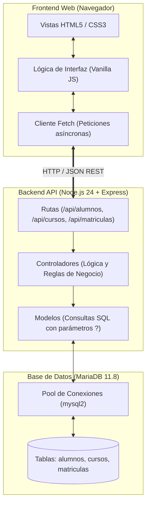
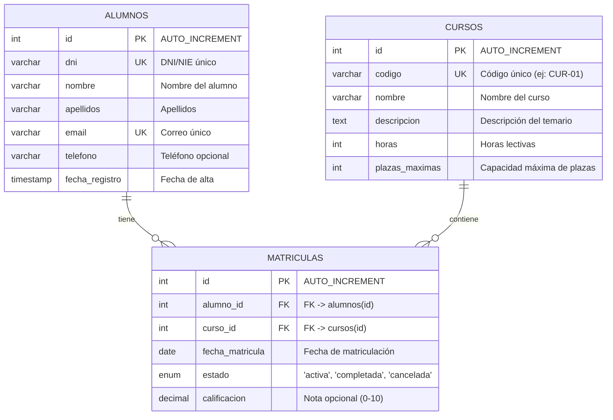

# PLAN DE PROYECTO: ClassManager

**Asignatura:** Sostenibilidad aplicada al sistema productivo  
**Ciclo:** 2º Grado Superior en Desarrollo de Aplicaciones Web (DAW) — Curso 2026-2027  
**Centro:** SEAS, Centro de Formación Abierta / Fundación San Valero  
**Entorno de Trabajo:** Node.js 24 LTS & MariaDB 11.8  
**Herramienta de Desarrollo Asistido:** Google Antigravity  

---

## 1. Descripción del Proyecto y Justificación de Sostenibilidad

**ClassManager** es una aplicación web para la gestión académica y administrativa de alumnos, cursos formativos y matrículas en un centro educativo. El objetivo es digitalizar los trámites manuales de matriculación y consulta para sustituir el uso de registros en papel por un sistema centralizado, ágil y seguro.

### Alineación con la Sostenibilidad (Green Software)
1. **Desmaterialización (Cero Papel):** Digitalización completa de inscripciones, listados de clase y fichas de alumnos mediante una base de datos relacional.
2. **Eficiencia Energética y Código Ligero:**
   - **Frontend nativo:** Uso exclusivo de **HTML5, CSS3 y JavaScript Vanilla (ES6+)** sin frameworks pesados (React, Angular). Esto elimina procesos de compilación y reduce al mínimo el peso de la web en red y el consumo de CPU y memoria en los equipos cliente.
   - **Backend asíncrono y optimizado:** Servidor ligero con **Node.js 24** y Express, procesando peticiones de forma no bloqueante con mínimo consumo de recursos.
3. **Persistencia Sostenible:** Uso de **MariaDB 11.8** con un pool de conexiones reutilizables y consultas preparadas con parámetros, evitando sobrecargar el servidor de base de datos.

---

## 2. Funcionalidades y Reglas de Negocio

El sistema organiza sus operaciones en cuatro bloques directos y funcionales:

- **Gestión de Alumnos (CRUD):** Alta, consulta, edición y baja de estudiantes. DNI y correo electrónico obligatorios y únicos.
- **Gestión de Cursos (CRUD):** Alta, consulta, edición y baja de acciones formativas con código único, denominación, horas lectivas y límite de plazas máximas.
- **Gestión de Matrículas:**
  - Registro de matrículas asociando alumno y curso con selector dinámico.
  - **Control de duplicados activos en backend:** Antes de insertar, el servidor verifica que el alumno no tenga ya una matrícula con estado `activa` en dicho curso.
  - **Rematriculación natural:** Si un alumno tuvo una matrícula previa pero su estado actual es `cancelada` o `completada`, el sistema le permite volver a matricularse con una nueva inscripción activa.
  - **Control de aforo:** El backend comprueba que el número de matrículas activas del curso no supere las plazas máximas disponibles.
  - **Gestión de estados:** Posibilidad de cambiar el estado de la matrícula entre `activa`, `completada` y `cancelada`, así como registrar la calificación final.
- **Consultas Cruzadas:**
  - **Alumnos inscritos por curso (Requisito clave):** Al seleccionar un curso, se muestra la relación de todos los alumnos que forman parte de él.
  - **Historial del alumno:** Visualización de los cursos en los que un alumno está o ha estado inscrito.
- **Regla de Integridad de Borrado:** No se permite eliminar un alumno ni un curso si tiene cualquier matrícula vinculada, garantizado mediante la restricción `ON DELETE RESTRICT`.

---

## 3. Tecnologías y Entorno de Ejecución

| Componente | Tecnología | Versión | Uso en el Proyecto |
| :--- | :--- | :--- | :--- |
| **Backend Runtime** | **Node.js** | **v24 LTS** | Entorno de ejecución de servidor asíncrono. |
| **Framework Backend** | **Express.js** | **v4.x** | Enrutamiento HTTP, middleware y API REST. |
| **Base de Datos** | **MariaDB** | **11.8** | SGBD relacional con motor InnoDB y soporte de claves foráneas. |
| **Driver de BD** | **`mysql2/promise`** | **v3.x** | Gestión de pool de conexiones y consultas SQL preparadas seguras. |
| **Frontend** | **HTML5 / CSS3 / JS Vanilla** | **Nativo (ES6+)** | Interfaz web responsiva, ligera y sin librerías externas. |
| **Comunicación** | **Fetch API / JSON** | **Estándar** | Comunicación asíncrona cliente-servidor con promesas. |
| **Testing** | **Jest + Supertest** | **v29.x / v7.x** | Pruebas automatizadas de integración para los endpoints de la API. |
| **Configuración** | **`dotenv`** | **v16.x** | Carga de credenciales y variables de entorno desde `.env`. |

---

## 4. Arquitectura del Sistema

La aplicación sigue una **arquitectura en capas cliente-servidor** clásica, limpia y fácil de defender:



### Principios de Implementación:
1. **Separación de responsabilidades:** El frontend solo maneja la interfaz y consume la API; el backend resuelve la lógica de negocio y la persistencia.
2. **Seguridad contra SQL Injection:** Todas las consultas SQL utilizan sentencias preparadas con comodines `?` mediante `mysql2`.
3. **Manejo uniforme de errores:** Respuestas JSON consistentes con códigos de estado HTTP estándar (200, 201, 400, 404, 409 y 500).

---

## 5. Modelo de Datos Relacional (3 Tablas)

El modelo está compuesto estrictamente por **tres tablas relacionadas** estándar, sin artificios innecesarios:



### Script DDL de Referencia (`schema.sql`)

```sql
-- 1. Tabla de Alumnos
CREATE TABLE alumnos (
    id INT AUTO_INCREMENT PRIMARY KEY,
    dni VARCHAR(10) NOT NULL UNIQUE,
    nombre VARCHAR(50) NOT NULL,
    apellidos VARCHAR(100) NOT NULL,
    email VARCHAR(100) NOT NULL UNIQUE,
    telefono VARCHAR(15) NULL,
    fecha_registro TIMESTAMP DEFAULT CURRENT_TIMESTAMP
);

-- 2. Tabla de Cursos
CREATE TABLE cursos (
    id INT AUTO_INCREMENT PRIMARY KEY,
    codigo VARCHAR(20) NOT NULL UNIQUE,
    nombre VARCHAR(100) NOT NULL,
    descripcion TEXT NULL,
    horas INT NOT NULL CHECK (horas > 0),
    plazas_maximas INT NOT NULL CHECK (plazas_maximas > 0)
);

-- 3. Tabla de Matrículas (Relación N:M)
CREATE TABLE matriculas (
    id INT AUTO_INCREMENT PRIMARY KEY,
    alumno_id INT NOT NULL,
    curso_id INT NOT NULL,
    fecha_matricula DATE NOT NULL DEFAULT (CURRENT_DATE),
    estado ENUM('activa', 'completada', 'cancelada') NOT NULL DEFAULT 'activa',
    calificacion DECIMAL(4,2) NULL,
    CONSTRAINT fk_matricula_alumno FOREIGN KEY (alumno_id) REFERENCES alumnos(id) ON DELETE RESTRICT,
    CONSTRAINT fk_matricula_curso FOREIGN KEY (curso_id) REFERENCES cursos(id) ON DELETE RESTRICT
);
```

---

## 6. Especificación de la API REST

Formato homogéneo de respuesta JSON:
- **Respuesta satisfactoria:** `{ "success": true, "data": ..., "message": "..." }`
- **Respuesta de error:** `{ "success": false, "error": "Descripción del error" }`

| Recurso | Verbo | Ruta | Descripción | Códigos HTTP |
| :--- | :--- | :--- | :--- | :--- |
| **Alumnos** | `GET` | `/api/alumnos` | Listar todos los alumnos | `200` |
| **Alumnos** | `GET` | `/api/alumnos/:id` | Obtener datos de un alumno | `200`, `404` |
| **Alumnos** | `POST` | `/api/alumnos` | Registrar nuevo alumno (valida DNI/email únicos) | `201`, `400`, `409` |
| **Alumnos** | `PUT` | `/api/alumnos/:id` | Modificar datos de un alumno | `200`, `400`, `404`, `409` |
| **Alumnos** | `DELETE` | `/api/alumnos/:id` | Eliminar alumno (bloqueado con 409 si tiene matrículas) | `200`, `404`, `409` |
| **Cursos** | `GET` | `/api/cursos` | Listar cursos con plazas totales y ocupadas | `200` |
| **Cursos** | `GET` | `/api/cursos/:id` | Obtener detalle de un curso | `200`, `404` |
| **Cursos** | `GET` | `/api/cursos/:id/alumnos` | **Consultar alumnos inscritos en un curso (Obligatorio)** | `200`, `404` |
| **Cursos** | `POST` | `/api/cursos` | Registrar nuevo curso | `201`, `400`, `409` |
| **Cursos** | `PUT` | `/api/cursos/:id` | Modificar datos del curso | `200`, `400`, `404` |
| **Cursos** | `DELETE` | `/api/cursos/:id` | Eliminar curso (bloqueado con 409 si tiene matrículas) | `200`, `404`, `409` |
| **Matrículas** | `GET` | `/api/matriculas` | Listar matrículas con datos combinados (`JOIN`) | `200` |
| **Matrículas** | `POST` | `/api/matriculas` | Matricular alumno (valida aforo y no duplicidad activa) | `201`, `400`, `404`, `409` |
| **Matrículas** | `PUT` | `/api/matriculas/:id/estado` | Modificar estado (`activa`, `completada`, `cancelada`) o nota | `200`, `400`, `404` |
| **Matrículas** | `DELETE` | `/api/matriculas/:id` | Eliminar registro de matrícula | `200`, `404` |

---

## 7. Requisito 2: Skill Personalizada de IA

Cumpliendo con el enunciado de la actividad (*"incorporar al proyecto al menos una Skill personalizada"*), se crea una única Skill reutilizable:

- **Nombre:** `rest-endpoint-generator`
- **Ubicación:** `.gemini/skills/rest-endpoint-generator/SKILL.md`
- **Finalidad:** Guía al agente de IA para implementar rutas y controladores en Express siguiendo siempre las mismas pautas:
  - Uso de funciones asíncronas (`async/await`) con bloques `try/catch`.
  - Respuestas JSON uniformes (`success`, `data`, `error`).
  - Uso riguroso de códigos HTTP estándar (200, 201, 400, 404, 409, 500).
  - Sanitización y validación de campos obligatorios antes de interactuar con MariaDB.

---

## 8. Criterios de Aceptación (Definition of Done)

- [ ] **Alumnos:** Operaciones CRUD completas funcionando. Se impide registrar DNI o email repetidos. Se bloquea el borrado si tiene matrículas.
- [ ] **Cursos:** Operaciones CRUD completas con horas y plazas válidas (> 0). Se bloquea el borrado si tiene matrículas.
- [ ] **Matrículas y Aforo:** El sistema valida que el curso tenga plazas libres antes de matricular.
- [ ] **Prevención de Duplicados:** Si el alumno ya tiene una matrícula `activa` en el curso, el backend responde con código `409 Conflict`.
- [ ] **Rematriculación:** Si la matrícula anterior está en estado `cancelada` o `completada`, el alumno puede volver a matricularse sin errores.
- [ ] **Consulta de Alumnos por Curso:** Se puede consultar en cualquier momento la lista de alumnos inscritos en un curso determinado.
- [ ] **Integridad en BD:** Tres tablas relacionadas creadas en MariaDB 11.8 con restricciones de clave foránea `ON DELETE RESTRICT`.
- [ ] **Frontend Funcional:** Interfaz web intuitiva en Vanilla JS que permite realizar todas las operaciones y muestra mensajes de éxito o error al usuario.

---

## 9. Requisito 4: Plan de Pruebas Automatizadas

Se utilizará **Jest y Supertest** para verificar de forma automatizada los endpoints clave y generar las evidencias exigidas por la actividad:

| ID | Módulo | Caso de Prueba | Condición evaluada | Código HTTP |
| :--- | :--- | :--- | :--- | :--- |
| **T-01** | Alumnos | Alta correcta | Datos válidos y únicos | `201 Created` |
| **T-02** | Alumnos | Validación de datos | DNI o email vacío o inválido | `400 Bad Request` |
| **T-03** | Alumnos | Duplicidad | DNI o email ya existente | `409 Conflict` |
| **T-04** | Cursos | Alta correcta | Código único y plazas > 0 | `201 Created` |
| **T-05** | Cursos | Alumnos de un curso | Consulta con ID de curso válido | `200 OK` con lista de alumnos |
| **T-06** | Matrículas | Matriculación válida | Alumno y curso con plazas disponibles | `201 Created` |
| **T-07** | Matrículas | Bloqueo duplicado activo | Alumno con matrícula activa previa en ese curso | `409 Conflict` |
| **T-08** | Matrículas | Rematriculación permitida | Alumno con matrícula previa cancelada | `201 Created` |
| **T-09** | Matrículas | Aforo lleno | Curso sin plazas disponibles | `400 Bad Request` |
| **T-10** | Integridad | Borrado protegido | `DELETE /api/alumnos/:id` con matrícula asociada | `409 Conflict` (`RESTRICT`) |

**Evidencias de Pruebas:** La ejecución del comando `npm test` en la consola se registrará en el documento de evidencias para adjuntar a la entrega.

---

## 10. Estructura de Directorios del Proyecto

```text
ClassManager/
├── .gemini/
│   └── skills/
│       └── rest-endpoint-generator/
│           └── SKILL.md            # Única Skill personalizada reutilizable
├── src/
│   ├── config/
│   │   └── db.js                   # Pool de conexiones MariaDB con mysql2
│   ├── controllers/
│   │   ├── alumnosController.js    # Lógica de alumnos
│   │   ├── cursosController.js     # Lógica de cursos
│   │   └── matriculasController.js # Lógica de matrículas y aforo
│   ├── models/
│   │   ├── alumnoModel.js          # Consultas SQL para alumnos
│   │   ├── cursoModel.js           # Consultas SQL para cursos
│   │   └── matriculaModel.js       # Consultas SQL para matrículas
│   ├── routes/
│   │   ├── alumnosRoutes.js        # Rutas /api/alumnos
│   │   ├── cursosRoutes.js         # Rutas /api/cursos
│   │   └── matriculasRoutes.js     # Rutas /api/matriculas
│   ├── middlewares/
│   │   └── errorHandler.js         # Manejador central de errores
│   └── app.js                      # Configuración y arranque de Express
├── public/
│   ├── css/
│   │   └── styles.css              # Estilos limpios y responsivos
│   ├── js/
│   │   ├── api.js                  # Peticiones Fetch centralizadas
│   │   └── main.js                 # Lógica de interfaz (alumnos, cursos, matrículas)
│   └── index.html                  # Interfaz de usuario única con pestañas
├── database/
│   ├── schema.sql                  # Script DDL de las 3 tablas
│   └── seeds.sql                   # Datos de prueba iniciales
├── tests/
│   ├── api.test.js                 # Batería de pruebas automatizadas (Jest + Supertest)
├── .env.example                    # Plantilla de variables de entorno
├── package.json                    # Dependencias y scripts
├── PLAN.md                         # Planificación del proyecto (este documento)
└── README.md                       # Manual de instalación y ejecución
```

---

## 11. Fases de Desarrollo Iterativo

1. **Fase 1: Planificación (Cerrada):** Aprobación del presente documento `PLAN.md`.
2. **Fase 2: Configuración, Base de Datos y Skill:** Creación de `package.json`, scripts `schema.sql` y `seeds.sql`, conexión MariaDB (`db.js`) y Skill `rest-endpoint-generator`.
3. **Fase 3: Backend y API REST:** Desarrollo de modelos, controladores y rutas para alumnos, cursos y matrículas, aplicando las validaciones de negocio.
4. **Fase 4: Pruebas Automatizadas y Corrección con IA:** Creación y ejecución de la batería de tests en Jest y registro de evidencias de consola.
5. **Fase 5: Frontend Web:** Construcción de `index.html`, `styles.css` y `main.js` consumiendo la API REST.
6. **Fase 6: Verificación Final y Documentación:** Pruebas funcionales en navegador, redacción del `README.md` y revisión de la lista de entregables.
